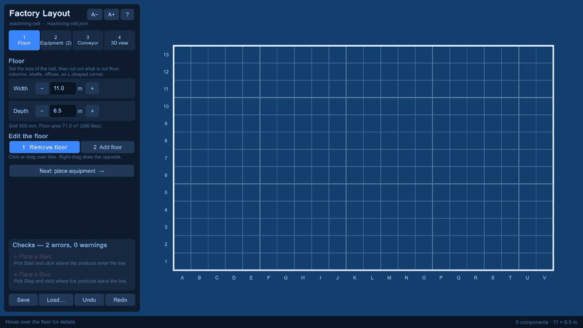
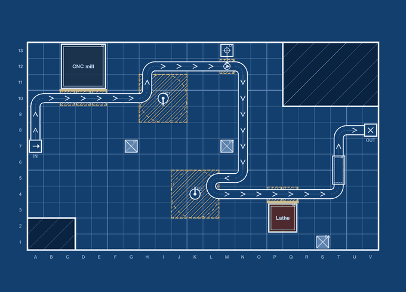
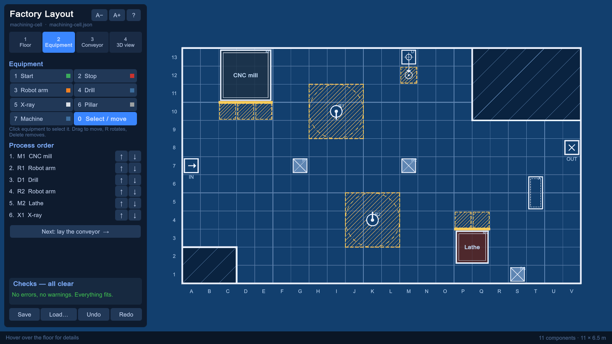
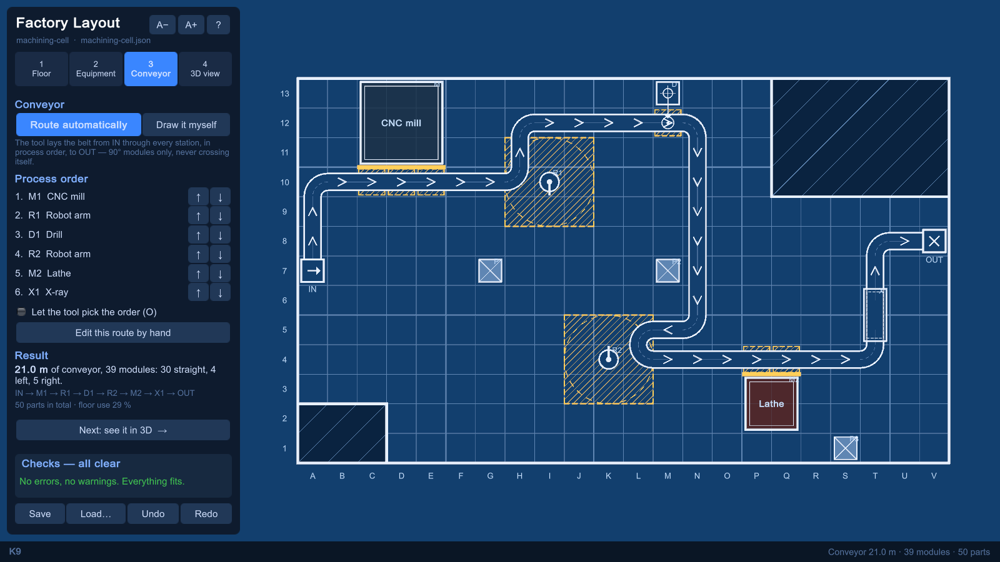
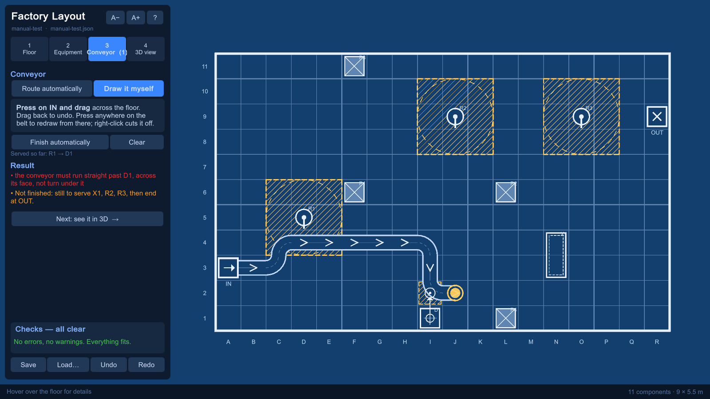
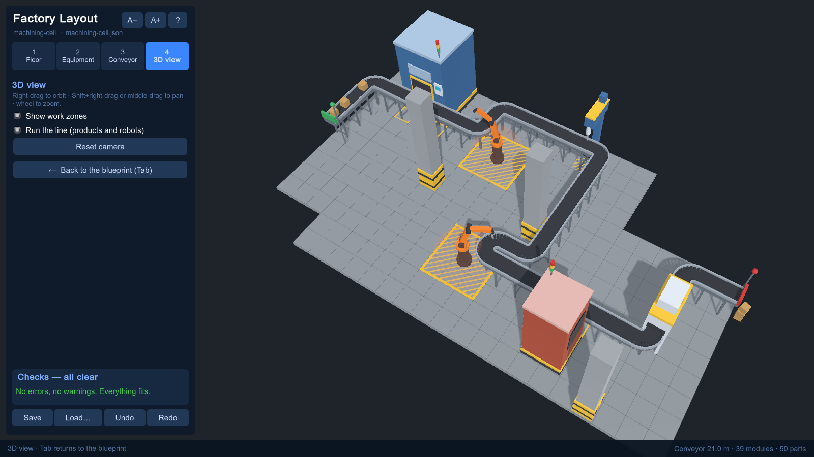

# Factory Layout Generator

Plan a production line in four steps — floor, equipment, conveyor, 3D — and the tool:
- checks every step against real constraints while you work, and says how to fix what fails;
- routes the conveyor through every station, or checks the one you draw yourself;
- turns the drawing into a 3D line with the products running.

An optional builder makes the same layout in CATIA V5, one PowerCopy per part. It is
compiled but not yet run against CATIA.

> The idea comes from a course assignment in **TMKT57 — Product Modelling** (Linköping
> University): a CATIA form that could place machines but never finished the conveyor. This
> version is rebuilt from the ground up, and all of its code and models are new.



*Recorded from the built player (`-demo`). The hall is cut to an L-shape. The equipment goes in
piece by piece, each one checked: a CNC mill and a lathe as custom machines, two robot arms, a
drill, an X-ray tunnel. The conveyor is drawn from IN and checked as it grows. Then the
blueprint takes 3D form and the line runs. A smaller WebP version is
[docs/images/demo_workflow.webp](docs/images/demo_workflow.webp).*



| Step 2: equipment | Step 3: conveyor |
|---|---|
|  |  |
| **A hand-drawn conveyor being checked** | **Step 4: 3D** |
|  |  |

## What it does

1. **Floor.** The hall's size in metres on a 0.5 m grid. Tiles that are not floor can be cut out:
   columns, shafts, offices, an L-shaped corner.
2. **Equipment.** Start, Stop, robot arms, drills, X-ray tunnels, building columns, and
   **machines of any size** (1–8 × 1–8 tiles, with their own name and colour). Every edit is
   checked at once against the space the equipment needs:
   - A **robot arm stands on one tile but needs the 3×3 around it to move.** Nothing else may
     stand there, and it may not reach past a wall.
   - A **drill works on the tile in front of it**, over the belt. The belt runs straight through
     that tile, and no robot arm may reach in, so arm and drill head cannot collide.
   - A **machine is loaded from one side**, and the belt must pass along that side.
   - An X-ray tunnel needs both ends free.
3. **Conveyor.** The conveyor appears only now, so it does not jump around while equipment is
   being placed. Two ways to make it:
   - **Route automatically:** from IN, through every station in process order, to OUT, in
     whole-tile modules with **90° turns**, never crossing itself. Turns cost more than
     straights, so the router prefers fewer of them. It can also propose the station order
     that gives the cheapest conveyor.
   - **Draw it myself:** press on IN and drag. The engine checks the belt as it is drawn and says
     what is wrong ("must run straight past D1") or still missing ("still to serve R2"). Draw the
     tricky part, then let the tool finish the rest.
4. **3D.** Press Tab: the camera tilts out of the drawing, the paper turns to concrete, the line
   grows out of the floor, the arms start working and boxes ride the belt.

Around the steps:
- **Checks** lists every problem with a one-line fix. Click one and it lights up on the drawing.
- A **guided tour** on first start, skippable, and back any time with `?`.
- **Scalable text:** `A−`/`A+` or `Ctrl` `+`/`−`. It also scales automatically with the screen.
- **Undo and redo.** Save writes `layout.json` plus a blueprint `.svg`.

## Results

Measured, not estimated. Full table: [docs/results/bench.md](docs/results/bench.md). 300
random valid layouts per size, with the stations' process order **random**. That is harder
than a real line, which a person draws in process order.

| layout | fixed order, greedy | fixed order, backtracking | tool picks the order | median time |
|---|---:|---:|---:|---:|
| 12×8, 3 stations | 56% | 74% | **99%** | 0.6 ms |
| 14×10, 4 stations | 47% | 72% | **99%** | 1.9 ms |
| 20×15, 7 stations | 10% | 31% | **97%** | 44 ms |

- **0 of the routes reported as successful were rejected** by `RouteChecker`, a separate
  implementation of the rules that shares no code with the router. That includes the drill
  rule: straight through the work cell.
- **Backtracking matters.** Greedy routing (the cheapest path to each station in turn) often
  walls the conveyor in on the way to the next station. Trying each station's other endings
  routes 24–48% of the layouts that greedy routing fails.
- **Process order matters most.** A random order across a large floor is often infeasible.
  The router then needs the order to be choosable, and in the editor it can propose one.
- Routes that fail are **not proven impossible**: the search is exact per segment but does not
  try every path. Worst case: 1.3 s, a 20×15 floor with order search.
- These numbers are higher than in the first version of this table. That is **not** because
  the router improved. The validator now rejects drills whose work cell has no straight
  passage, so the generator no longer produces those impossible layouts. The two tables are
  different layout sets and should not be compared.

Demo layouts, both routed in placement order and passing every check:
- `layouts/machining-cell.json`: 11 × 6.5 m L-shaped hall, CNC mill 3×3, lathe 2×2, 2 robots,
  drill, X-ray. 21 m conveyor, 50 parts.
- `layouts/demo-line.json`: 9 × 5.5 m, 3 robots, drill, X-ray. 17.5 m conveyor, 43 parts.

**Not yet measured:** whether planning with the tool is faster and gives fewer mistakes than
planning by hand. That is the claim worth making, and [docs/USER_TEST.md](docs/USER_TEST.md) is
the protocol for testing it. Until it has been run, the project makes no time-saving claim.

## How it works

```
   Unity editor  ──►  layout.json  ──►  CATIA V5 builder (optional, unverified)
   (4 steps, 3D)      (the contract)    (one PowerCopy per part)
          \                │                 /
           └──── FactoryLayout.Core (C#) ───┘
                 validation · routing · checking drawn belts · CAD plan · blueprint SVG
```

- **One engine, three hosts.** The engine targets netstandard2.0, so the same DLL runs in
  Unity, in the .NET Framework 4.8 CATIA builder and in .NET 9 tests and CLI. Whoever reads a
  layout re-validates and re-routes it, so the editor and CAD can never disagree.
- **Routing:** Dijkstra over (cell, heading), so turns can be priced. The conveyor already laid
  is an obstacle, as the cable's own trail was in my cable-routing project. Then depth-first backtracking over
  each station's possible endings. For order search: every order up to 6 stations, a swap
  search beyond.
- **Everything visual is built at runtime** from primitives: no imported models, no physics.
  Scenes are generated by an editor script.

## Run it

```powershell
dotnet test tests\FactoryLayout.Core.Tests                     # 36 tests
dotnet run --project src\FactoryLayout.Cli -- route layouts\demo-line.json --svg out.svg
dotnet run -c Release --project src\FactoryLayout.Cli -- bench --out docs\results\bench.md
.\tools\build_and_shoot.ps1 -Frames -Tour                      # build the Unity player + screenshots
Build\FactoryLayout\FactoryLayout.exe                          # the editor
# record the workflow demo shown at the top, then stitch it:
Build\FactoryLayout\FactoryLayout.exe -layout layouts\machining-cell.json -frames out -demo
python tools\make_gif.py out docs\images\demo_workflow.gif docs\images\demo_workflow.webp
```

Editor keys:

| Key | Action |
|---|---|
| `F1`–`F4` | steps: floor, equipment, conveyor, 3D |
| `Tab` | blueprint ⇄ 3D |
| `1`–`7`, `0` | in step 2: Start, Stop, Robot, Drill, X-ray, Pillar, Machine; `0` select/move |
| `R` | rotate (big machines turn in place) |
| Right-click | delete equipment, cut the drawn belt, or add floor back (step 1) |
| `Ctrl+Z` / `Ctrl+Y` | undo / redo |
| `O` | let the tool pick the order |
| `Ctrl+S` | save `layout.json` + `.svg` |
| `Ctrl` `+` / `−` / `0` | text size |

Requirements:
- .NET SDK 9 for the engine, tests and CLI.
- Unity 6000.5.7f1 (Built-in pipeline) for the editor.
- CATIA V5 only for `catia/`.

## Layout

| Path | |
|---|---|
| `src/FactoryLayout.Core` | the engine |
| `src/FactoryLayout.Cli` | `route`, `bench` |
| `tests/` | unit tests |
| `unity/` | the editor; `Assets/Editor/FactoryBuild.cs` generates the scene and builds the player |
| `catia/` | CATIA V5 builder and template spec |
| `layouts/` | example layouts |
| `tools/` | build-and-screenshot script, GIF maker |
| `docs/` | project history, results, user-test protocol, images |

The full story, including what the course version got wrong and every decision since:
[docs/PROJECT_HISTORY.md](docs/PROJECT_HISTORY.md).
